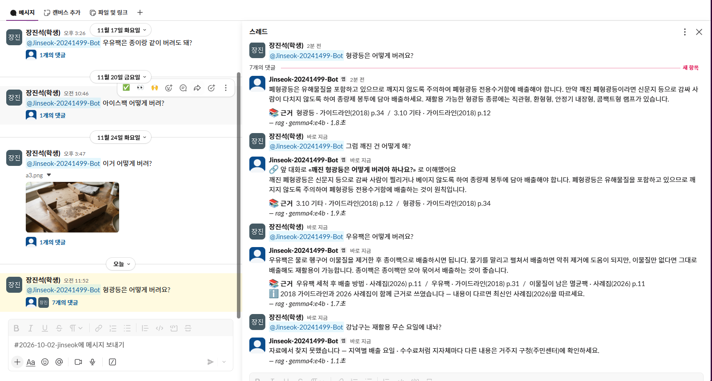
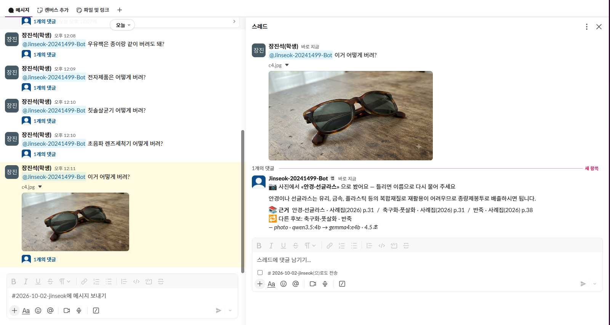
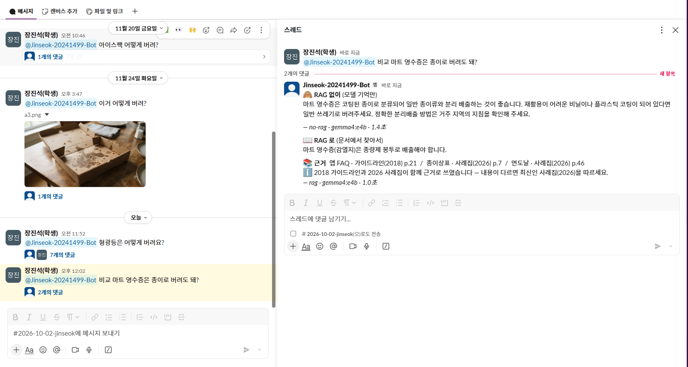
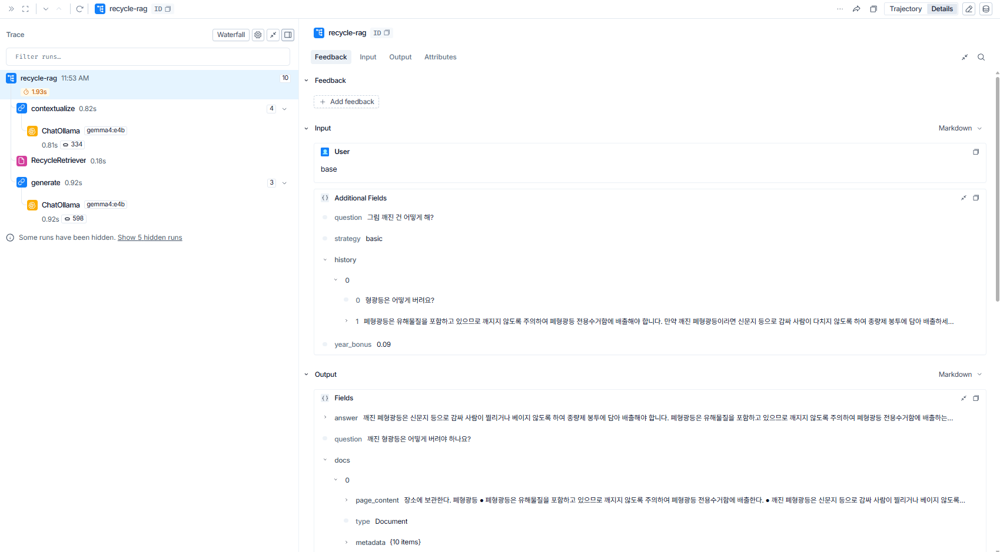
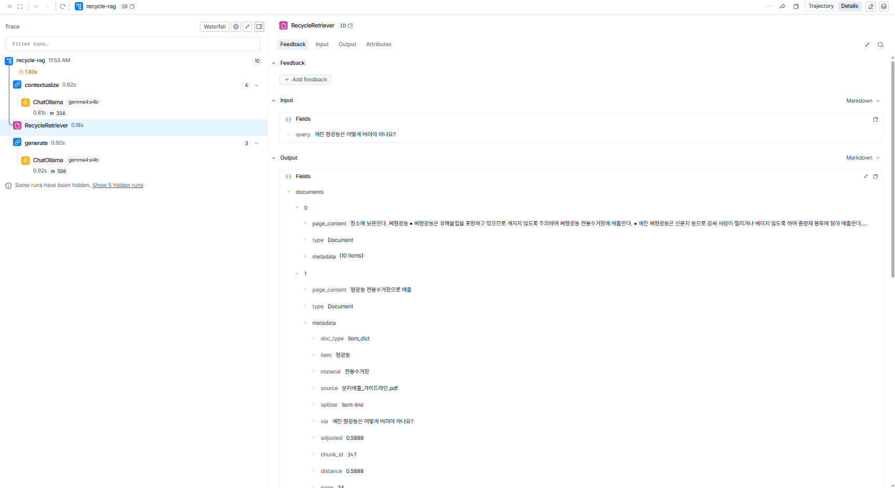
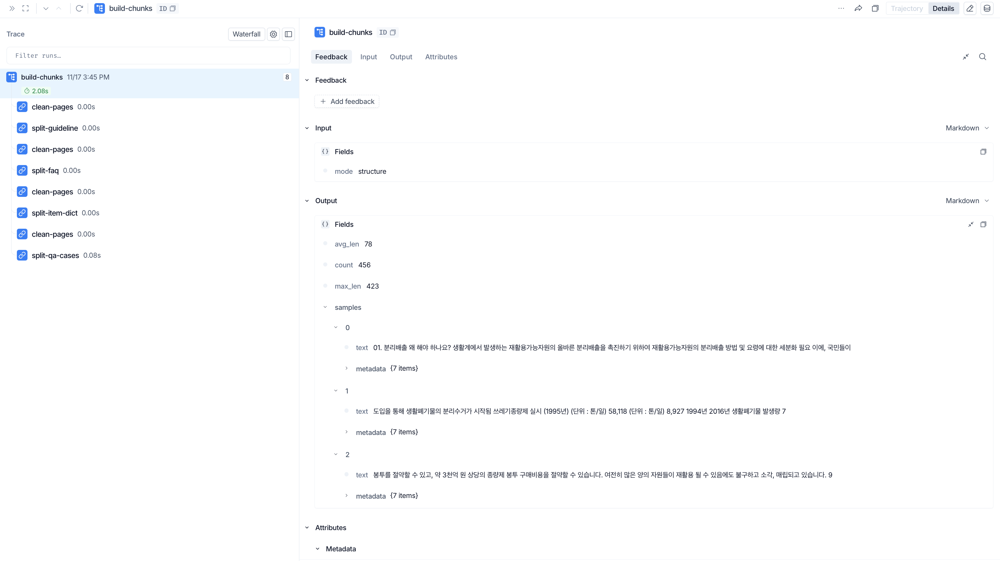
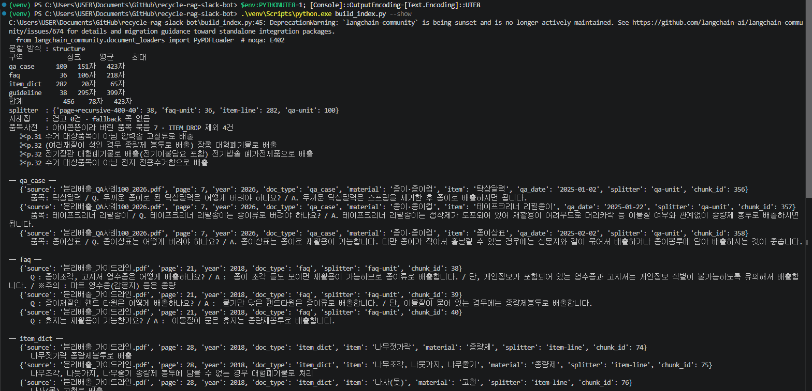
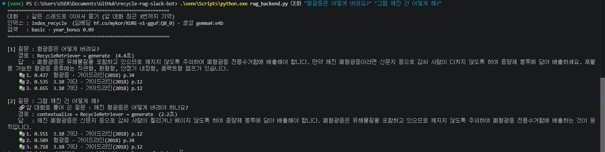

# 버릴지도 — 슬랙에서 묻는 분리배출 안내 봇 (RAG)

> **«뽁뽁이는 어떻게 버려요?»** 라고 슬랙에 묻거나 **사진을 올리면**, 환경부 가이드라인과 2026 분리배출 Q&A 사례집에서
> 근거를 찾아 **배출 방법과 출처(문서 · 쪽 · 품목)** 를 함께 답합니다. 같은 스레드에서는 **«그럼 깨진 건?»** 처럼 이어서 물어도 됩니다.
>
> 숫자는 모두 **실제로 돌려서 잰 값**입니다(RTX 3070 8GB · 마지막 측정 2026-11-27).
> 요구사항 명세 · 실측 기록 → [CONTEXT.md](CONTEXT.md) · 평가 원본 → [eval_results/](eval_results/) ·
> **최종 제출 기준(11-25) 대조 → 7번 테스트표 · 맨 아래 «최종 제출 기준 대조»**
>
> «최신인공지능»(2026) 수업의 미니 프로젝트입니다. 본문의 «N주차 · N교시» 는 그 수업의 차시이고,
> 수업 실습 코드 · 강의 자료는 수업 저장소 [langchain-2026-20241499](https://github.com/Jinseok2419342/langchain-2026-20241499) 에 있습니다.
> 이 저장소는 그 저장소의 [`mini_project/`](https://github.com/Jinseok2419342/langchain-2026-20241499/tree/59cd1d32546a399a8c8cfeb17bfc6110fc5343c3/mini_project) 를 커밋 기록째 옮겨 온 것입니다(2026-11-20).

```
   슬랙  @버릴지도 아이스팩 어떻게 버려?          슬랙  📷 사진 + @버릴지도
     │                                               │
     │                                               ▼
     │                                    ⓪ 이름   사진 → 문서 품목 이름 377개 중 하나   ← 사진 qwen3.5:4b
     ▼                                               ▼
   ① 검색   분리배출 문서 2건(88쪽 · 456청크) → 가까운 근거 3개          ← 임베딩 KURE-v1 (고려대 · 한국어 검색 특화)
   ② 생성   근거 + 질문 → 답 (근거에 없으면 «찾지 못했습니다»)           ← 생성 gemma4:e4b (Google)
     │
     ▼
   슬랙 스레드  📷 사진에서 «아이스팩» 으로 봤어요 — 틀리면 이름으로 다시 물어 주세요

               아이스팩은 종량제 봉투로 배출해야 합니다.

               📚 근거  아이스팩 · 가이드라인(2018) p.31  /  핫팩 · 가이드라인(2018) p.34  /  우유팩 · 가이드라인(2018) p.31
               🔁 다른 후보: 핫팩 · 우유팩
               — photo · qwen3.5:4b → gemma4:e4b · 4.3초    ← 봇 코드가 실제 모델로 만든 답 그대로 (2026-11-24 · photos/c2.jpg)
```

---

## 1. 목적

자취를 시작한 대학생 · 1인 가구는 **아이스팩, 마트 영수증, 깨진 유리, 다 쓴 선글라스**처럼 애매한 쓰레기를 버릴 때마다 검색하지만,
블로그 답은 서로 다르고 **출처가 없습니다**(실제로 «영수증은 종이류» 라는 답이 흔하지만, 감열지 영수증은 종량제봉투 대상입니다).
이 봇은 슬랙에서 **생활 용어 그대로** 물으면 **공식 문서(환경부 가이드라인 · 2026 Q&A 사례집)** 에서 근거를 찾아
**배출 방법을 출처와 함께** 알려 주어, «어디에 그렇게 쓰여 있는가» 를 바로 확인할 수 있게 합니다.
**이름을 모르면 사진으로** 물어도 됩니다 — 사진은 품목 이름을 붙이는 데만 쓰고, 답은 똑같이 문서에서 출처와 함께 만듭니다.

## 2. 기능

| 슬랙 메시지 | 하는 일 |
|---|---|
| `@버릴지도 아이스팩 어떻게 버려?` | 문서에서 근거 3개를 찾아 **세 문장 이내로 답** + 📚 **근거(품목 · 문서 · 쪽)** |
| (같은 스레드) `@버릴지도 그럼 깨진 건 어떻게 해?` | 🔗 **이어 묻기** — 앞 대화로 «깨진 폐형광등은 어떻게 버려야 하나요?» 처럼 풀어 쓴 뒤 찾아 답 + 무엇으로 알아들었는지 한 줄 |
| **📷 사진 + `@버릴지도`** (DM 은 사진만) | 사진 속 물건에 **문서의 품목 이름**을 붙이고 → 그 이름으로 찾아 답 + 📚 근거 + «📷 무엇으로 봤는지» + 🔁 다른 후보 |
| `@버릴지도 검색 뽁뽁이` | 어떤 근거가 뽑혔는지만 보여 줌 — 거리 · 문서 · 쪽 (LLM 호출 없음 · 즉시) |
| `@버릴지도 비교 마트 영수증 종이로 버려도 돼?` | **RAG 없이** 답한 것과 **RAG 로** 답한 것을 나란히 — 모델이 지어내는지 바로 보임 |
| `@버릴지도 강남구 재활용 요일?` | 문서에 없는 질문 → **«자료에서 찾지 못했습니다 — 거주지 구청에 확인하세요»** (지어내지 않음) |
| `@버릴지도` (내용 없음) | 사용법 안내 |
| 봇에게 **DM** 으로 `핫팩은?` | 멘션 없이 1:1 로 물어도 같은 방식으로 답 (`message.im` 이벤트) |

- **채널 · DM 어디서든 묻고, 답은 같은 스레드에** 답니다 (6주차 4교시 · 9주차 3교시 봇 구조)
- **🔗 스레드마다 기억** — 13주차 기준 코드(`slack_bot/`)의 방식 그대로: 키 = «채널-스레드ts», 최근 3번(질문 + 답)을 기억하고,
  질문에 **«그럼 · 그거 · 아까 …»** 가 있을 때만 생성 모델이 «혼자 읽어도 되는 질문» 으로 풀어 쓴 뒤 검색합니다.
  풀어 쓴 질문에 원래 낱말이 하나도 없으면(주제가 바뀌면) 원문을 씁니다. 풀어 썼으면 답 맨 위에 «🔗 앞 대화로 «…» 로 이해했어요» 가 붙습니다.
  기억은 봇 안에만 둡니다 — 봇을 껐다 켜면 사라집니다(기준 코드의 `InMemorySaver` 와 같음).
- **생활 용어로 물어도 찾는다** — «뽁뽁이» → 에어캡, «돌돌이 리필은 어떻게 버려?» → 테이프크리너 리필종이, «아이스팩» → 냉동팩
  (임베딩 선택의 핵심 이유 · 3번 참고). 단 말투가 문서와 멀면 놓칩니다 — «돌돌이 리필 다 쓴 건 어디다 버림?» · «택배 상자» (6번 · 7번)
- **📷 사진은 «이름 붙이기» 에만** — 사진 모델이 문서에 실제로 있는 품목 이름(377개) 중에서 고르게 해 지어낸 이름이 나오지 않게 했고,
  무엇으로 봤는지(«📷 사진에서 «아이스팩» 으로 봤어요 — 틀리면 이름으로 다시 물어 주세요») 와 다른 후보를 늘 함께 보여 줍니다.
  버릴 물건이 안 보이는 사진(음식 접시 · 풍경)에는 «알아보지 못했어요 — 이름으로 물어봐 주세요» 로 답합니다.
  사진의 촬영 위치 정보(EXIF)는 버리고, LangSmith 에는 사진 대신 «<image N bytes>» 만 남깁니다.
- **최신 사례 우선** — 2026 사례집 청크의 거리를 조금(0.09) 줄여 앞세우고(`year` 메타데이터), 출처에 **연도**를 붙이며,
  근거에 2018 · 2026 이 섞이면 «ℹ️ 내용이 다르면 최신인 사례집(2026)을 따르세요» 를 덧붙임.
  실측: 연도 충돌 문항의 1위가 2026 문서인 수 2/4 → **4/4** · 검색 정답 수는 그대로 (CONTEXT 부록 D)
- 답은 먼저 «⏳ 찾는 중…» (사진은 «📷 사진을 보고 문서에서 찾는 중…») 으로 자리를 잡고, 답이 오면 그 메시지를 고칩니다 (9 · 10주차 봇과 같은 방식)

**실제 슬랙 화면** (제출 캡처 ③ · RTX 3070 8GB PC 에서 봇 실행 — 캡처 3종 전체는 맨 아래 «제출 캡처»)

> 테스트 당시 슬랙 봇 이름은 `@Jinseok-20241499-Bot` 으로 진행했습니다 (문서에서는 프로젝트 이름 `@버릴지도` 로 적음).



한 스레드(2026-11-27)에서 «형광등은 어떻게 버려요?» → 답 + 📚 근거(1.8초) →
**«그럼 깨진 건 어떻게 해?»(이어 묻기)** → «🔗 앞 대화로 «깨진 형광등은 어떻게 버려야 하나요?» 로 이해했어요» + 답 + 📚 근거(1.9초) →
«우유팩은 어떻게 버려요?» → 답 + 📚 근거 + ℹ️ 연도 안내(2018 · 2026 근거가 섞임 · 1.7초) →
«강남구는 재활용 무슨 요일에 내놔?» → «자료에서 찾지 못했습니다 — … 거주지 구청(주민센터)에 확인하세요»(근거 숨김 · 1.1초).



📷 선글라스 사진(`photos/c4.jpg`) + «이거 어떻게 버려?» → «📷 사진에서 «안경·선글라스» 으로 봤어요» →
«안경이나 선글라스는 유리, 금속, 플라스틱 등의 복합재질로 재활용이 어려우므로 종량제봉투로 배출하시면 됩니다.» + 📚 근거(안경·선글라스 · 사례집(2026) p.31 …) + 🔁 다른 후보 (4.5초 · 2026-11-27).
다른 후보(축구화·풋살화 · 반죽)는 엉뚱합니다 — 거리와 상관없이 검색 2 · 3위의 품목 이름을 그대로 보여 주기 때문입니다(개선 방향: 1위와 거리 차가 작을 때만 후보 표시).



`비교`: RAG 없이(모델 기억만)는 «마트 영수증은 코팅된 종이로 분류되어 일반 종이류와 분리 배출하는 것이 좋습니다…» — **틀림** /
RAG 로(문서에서 찾아서)는 «마트 영수증(감열지)은 종량제 봉투로 배출해야 합니다.» — **맞음** + 📚 근거 «앱 FAQ · 가이드라인(2018) p.21 …» (1.4 · 1.0초 · 2026-11-27).

## 3. 사용 모델과 선택 근거 ★

| 역할 | 수업 기본 | **이 프로젝트** | 출처 |
|---|---|---|---|
| 생성 (답) | `gemma3:4b` (Google) | **`gemma4:e4b`** (Google · 7.5B · 실효 4.5B · Q4_K_M) | [Ollama gemma4](https://ollama.com/library/gemma4:e4b) (Apache-2.0 · 2026-04) |
| 사진 → 품목 이름 | — | **`qwen3.5:4b`** (Alibaba · 4.2B · Q4_K_M) | [Ollama qwen3.5](https://ollama.com/library/qwen3.5) (Apache-2.0 · 2026-03) |
| 임베딩 | `qwen3-embedding:0.6b` (Alibaba) | **KURE-v1** 0.6B · Q8_0 · 1024차원 | [nlpai-lab/KURE-v1](https://huggingface.co/nlpai-lab/KURE-v1) (MIT) → GGUF [mykor/KURE-v1-gguf](https://huggingface.co/mykor/KURE-v1-gguf) |

생성 · 사진 모델은 Ollama 라이브러리에 있고, KURE-v1 은 **Ollama 라이브러리에 없는 한국어 특화 모델**이라 Hugging Face 의 GGUF 를 Ollama 로 직접 받습니다.

```bash
ollama pull gemma4:e4b                       # 생성 6.1 GB (사진 · 음성 입력 부품 포함 파일 크기)
ollama pull qwen3.5:4b                       # 사진 3.1 GB
ollama pull hf.co/mykor/KURE-v1-gguf:Q8_0    # 임베딩 0.6 GB
```

### 임베딩 — KURE-v1 · 근거: **품질(한국어 검색)** ★

- 고려대 NLP&AI 연구실이 **BGE-M3 를 한국어 질문-문서 200만 쌍으로 추가 학습**한 검색 전용 모델.
  한국어 검색 벤치마크 9종 평균(Top-1)에서 bge-m3 · multilingual-e5-large · OpenAI text-embedding-3-large 보다 높게 보고됨(모델 카드 · 금융 · 공공 · 의료 · 법률 PDF 검색 포함).
- **직접 잰 결과**(이 PC · 분리배출 문서 181청크 · 일상 말투 질문 15개, 바꾼 것은 임베딩뿐):

  | | qwen3-embedding:0.6b (수업 기본) | **KURE-v1** |
  |---|---|---|
  | 3교시 한국어 검증 margin (휴학 · 졸업 세트) | +0.018 ❌ 판정선 미달 | **+0.048** ✅ |
  | **Top-3 에 정답 근거** (봇이 넘기는 범위) | 12 / 15 | **15 / 15** |
  | 놓친 질문 | «뽁뽁이» · «아이스팩» · «핫팩» | 없음 |

  qwen3 이 놓친 셋은 모두 **문서와 다른 말로 물은 질문**입니다. 생활 용어로 묻는 봇이라 이 차이가 결정적입니다.
  인덱싱은 2배 느리지만(5.8초 → 10.4초) 한 번만 하는 일입니다.

### 생성 — gemma4:e4b · 근거: **품질(근거대로 답하기 · 지시 지키기)** · 속도 · 보안 · 오프라인

- 수업 기본 `gemma3:4b` 의 **직계 후속**(Google · 2026-04) — «수업 기본보다 나아졌는가» 를 같은 집안끼리 가장 깔끔하게 비교할 수 있습니다.
  실효 4.5B(층별 임베딩을 합치면 7.5B) · 사진 · 음성 입력 가능 · 생각(thinking) 모드가 있는 모델입니다.
- **직접 잰 결과** — 같은 인덱스(456청크) · 같은 30문항 · 같은 프롬프트, **바꾼 것은 생성 모델뿐** (2026-11-24 · CONTEXT 부록 E):

  | | gemma3:4b (수업 기본) | qwen3.5:4b (후보) | **gemma4:e4b** |
  |---|---|---|---|
  | **정답** | 15 / 30 | 25 / 30 | **29 / 30** ✅ |
  | 자기모순 (정답 뒤에 «찾지 못했습니다») | **11회** ⚠️ | 1회 | 1회 |
  | 범위 밖 질문 거절 («강남구 재활용 요일?» 등 4문항) | 3 / 4 | 2 / 4 ❌ | **4 / 4** |
  | 지시 바꾸기 공격 거절 (2문항) | 0 / 2 | 1 / 2 | **2 / 2** |
  | 품목사전 한 줄 답 (4문항) | 0 / 4 | 4 / 4 | 4 / 4 |
  | 답 1개 시간 (모델 로딩 후 · 평균) | 1.5초 | 1.2초 | **1.0초** |

  예) «아이스팩 어떻게 버리지» — gemma3:4b 는 정답을 말한 뒤 **«자료에서 찾지 못했습니다»** 를 덧붙여 스스로 뒤집었고,
  gemma4:e4b 는 «아이스팩은 겉 비닐과 안 합성수지 물질을 분리하여 … 통째로 버릴 경우에는 종량제 봉투로 배출하시면 됩니다.» 라고만 답했습니다.
  10주차와 같은 조건(옛 재귀 분할 181청크 · 6문항 · `scratch_eval.py`)으로도 **gemma3:4b 4/6 → gemma4:e4b 6/6** 입니다.
  qwen3.5:4b 는 정답 수는 높지만 범위 밖 질문에 «찾지 못했습니다» 대신 «자료에 포함되어 있지 않습니다» 로 답해(봇이 구청 안내로 바꾸지 못함) 범위 밖이 수업 기본보다 낮아 떨어뜨렸습니다.
- **틀린 1문항** «생수병은 어떻게 버려요?» — 검색이 정답 근거를 못 찾는 문항(6번)인데, gemma4:e4b 는 **지어내지 않고 «자료에서 찾지 못했습니다»** 라고 답했습니다(채점 규칙상 오답).
- ⚠️ **생각 모드는 꺼야 합니다** — 끄지 않으면 답 300토큰을 생각에 다 써서 **답이 빈칸**이 됩니다(실측 0/6 → 끈 뒤 6/6). 코드는 기본으로 끕니다(`RECYCLE_REASONING=off` → `think:false`).
- **보안 · 비용 · 오프라인**: 검색 · 생성 · 사진 모두 로컬(Ollama). 사용자의 질문 · 사진이 외부 LLM API 로 나가지 않고 상시 운영 비용이 0원.
  (LangSmith 추적(선택)을 켜면 질문 · 근거 · 답이 LangSmith 에 기록됩니다 — 사진은 올리지 않음 · 4번)
- 왜 더 큰 모델이 아닌가: 12B 이상은 8GB 에 안 올라갑니다(2교시 «피해야 할 기획»). 게다가 이 봇은 사진 모델과 함께 올라가야 합니다(아래 VRAM).

### 사진 → 품목 이름 — qwen3.5:4b · 근거: **품질(사진 적중)** · VRAM

사진 20장(평가 문항의 물건 · 문항 id 를 파일 이름으로)과 **버릴 물건이 아닌 사진 4장**(음식 접시 · 풍경 · 고양이 · 빈 책상)으로 쟀습니다.
채점은 글 질문과 같은 잣대 — **정답 품목이 검색 3위 안에 오나**(`questions.py` 의 정답 위치). 답은 모두 gemma4:e4b 가 만듭니다 (2026-11-24 · CONTEXT 부록 G).

| 사진에 이름을 붙이는 모델 · 방식 | 사진 적중 (/20) | 범위 밖 사진 (/4) | 사진 1장 |
|---|---|---|---|
| gemma3:4b (수업 기본) · 이름 지어내기 | 11 | 1 ~ 2 | 2.2초 |
| gemma4:e4b (생성 모델 그대로) · 지어내기 / 문서 품목 목록에서 고르기 | 6 ~ **8** / 4 ~ 7 | 3 ~ 4 | 1.5 ~ 2.4초 |
| qwen3.5:4b · 지어내기 | 6 | 2 ~ 3 | 1.6초 |
| **qwen3.5:4b · 문서 품목 목록(377개)에서 고르기 (채택)** | **16** (1위 14) | **2** | **4.1초** |

- **gemma4:e4b 한 모델로는 안 됐습니다** — 물건을 뭉뚱그려 부릅니다(뽁뽁이 · 아이스팩 · 택배 비닐 → 모두 «비닐봉투», 핫팩 → «쿠션»).
  사진을 1280px 로 키우기 · 사진 단계만 생각 모드 · 설명 줄까지 검색 등 6가지를 더 해 봤지만 최고 8/20 이었습니다.
- **qwen3.5:4b 에게 «문서에 있는 품목 이름 중에서 고르라»** 고 하자 16/20 — «완충재(뽁뽁이)» · «아이스팩» · «택배 비닐» · «치킨박스» · «칫솔살균기» 처럼 문서 표기 그대로 골라,
  검색이 바로 그 청크를 찾습니다. 글로는 못 찾던 **«생수병»** 도 사진에서는 «무색페트병» 으로 불러 정답 사례를 찾았습니다.
- 사진 → 답까지 맞은 것 **17/20**. 틀린 것: 돌돌이 리필(«모름») · 영수증(«신문지») · 소주 페트병(«유리병») · 면도날(«면도기» — 답은 같은 종량제라 맞음).
- ⚠️ **범위 밖 사진은 2/4** — 빈 책상 → «가구류»(책상도 대형폐기물이긴 함), 고양이 → 밑에 깔린 이불을 보고 «솜». 음식 · 풍경은 «알아보지 못했어요» ✅. 6번 «한계».
- ⚠️ 사진 세트는 **AI 로 생성한 이미지**(글자 · 로고 없이)이고, 지시문을 **같은 사진으로 고쳤습니다**(v1 → v2). 16/20 은 실제 폰 사진에서보다 좋게 나왔을 수 있습니다(6번).

### VRAM — 세 모델을 함께 올려 **실측 7.6 ~ 7.7 GB** · 8GB 안에 들어감 ✅ (여유 약 0.3 GB)

```
   ⚠️ 4주차 1교시의 계산법 + 실제로 올려서 잰 값 (RTX 3070 8GB · nvidia-smi · 화면 등 다른 프로그램 몫 약 0.8 GB 포함)

     파일 크기   생성 gemma4:e4b 6.1 GB  +  사진 qwen3.5:4b 3.1 GB  +  임베딩 KURE-v1 0.6 GB  =  9.8 GB   ← 계산으로는 8GB 초과
     ─────────────────────────────────────────────────────────────────────────────
     실측        아무것도 안 올림                       0.8 GB
                 gemma4:e4b + KURE (글 질문만)         6.1 ~ 6.5 GB
                 qwen3.5:4b + KURE                      5.2 ~ 5.4 GB
                 gemma4:e4b + qwen3.5:4b + KURE (봇)   7.6 ~ 7.7 GB   ← ollama ps: 셋 다 100% GPU · context 4096
```

> ✅ **계산만 하지 않고 실제로 올려 봤습니다** — 파일 크기를 더하면 8GB 를 넘지만, 실제로 세 모델을 함께 올리면 7.6 ~ 7.7GB 이고 `ollama ps` 는 셋 다 100% GPU 입니다.
> gemma4:e4b 는 «실효 4.5B» 모델이라 파일의 상당 부분(층별 임베딩)을 GPU 밖에 두는 것으로 보입니다 — `ollama ps` 의 크기 표시도 257 ~ 342MB 로 실제와 맞지 않아 **추정**입니다. 그래서 **판정은 실측으로** 합니다.
> ⚠️ 여유가 0.3GB 남짓뿐입니다 — 다른 모델(`gemma3:4b` · `qwen3-embedding` 등)이 GPU 에 남아 있으면 넘칩니다 → 봇 실행 전 `ollama ps` 확인. 한 모델만 쓰려면 `RECYCLE_VISION_MODEL=gemma4:e4b`(6.1 ~ 6.5GB · 대신 사진 적중 6 ~ 8/20).

## 4. 사용 스택

- **슬랙 봇** (입구 · 출구): `slack_bolt` Socket Mode — 10주차 [`slack_bot_mode/`](https://github.com/Jinseok2419342/langchain-2026-20241499/tree/59cd1d32546a399a8c8cfeb17bfc6110fc5343c3/11-06/slack_bot_mode) (수업 저장소) 에서 출발.
  봇(입구 · 출구)은 그대로 두고 **두뇌(`rag_backend.py` 의 문서 · 분할 · 모델)만 갈아 끼웁니다.** ★ 필수 요건
  사진은 봇 토큰(`files:read`)으로 표준 라이브러리 `urllib` 로 내려받고 Pillow 로 줄입니다.
- **13주차 기준 코드(`slack_bot/`)와의 관계** — 기준 코드도 같은 10주차 `slack_bot_mode` 에서 출발한 예시입니다.
  이 봇은 기준 코드가 나오기 전(11-14 ~)부터 10주차 코드를 직접 고쳐 만들었기 때문에, 기준 코드의 `bot_config.py` · `build_my_index.py` 대신
  **같은 역할의 파일**을 씁니다. 기준 코드에서 가져온 것은 **① 스레드마다 기억(`contextualize`)** 입니다(2번 · 아래 표 ⓪).
  기준 코드의 «PDF 500자 분할» 대신 문서 구조에 맞춘 분할(검색 정답 Top-3 19 → 23 / 24 · CONTEXT 부록 D)을 쓰려고 이 구성을 유지했습니다.

  | 기준 코드 (`13week_new/code/slack_bot/`) | 이 저장소 | 제출 캡처 |
  |---|---|---|
  | `python build_my_index.py --show` — 청크 수 · metadata | `python build_index.py --show` — 구역별 청크 수 · 출처 metadata | ① |
  | `python build_my_index.py` — `my_data/` → `index_my/` | `python build_index.py` — `data/*.pdf` 2건 → `index_recycle/` | |
  | `bot_config.py` — 주제 · 문서 이름 · 인덱스 · 출처 표시 | `config.py`(모델 · 인덱스 · 검색 값) · `rag_backend.py`(프롬프트 · `source_of` 출처 표시) | |
  | `python bot_graph.py --no-mcp` — 터미널에서 같은 스레드 대화 · 경로 · 📚 근거 | `python rag_backend.py 대화 "…" "그럼 …"` — 같은 스레드 대화 · 경로 · 📚 근거 | ② |
  | `python slack_agent_bot.py --no-mcp` | `python slack_rag_bot.py` | ③ |
  | `contextualize` · `FOLLOW_UP` · 체크포인터 `thread_id = 채널-스레드ts` | `rag_backend.contextualize_run` · `FOLLOW_UP` · `slack_rag_bot` 의 스레드 기억(키 = 채널-스레드ts) | ③ |
  | classify → search → grade → rewrite (Agentic RAG) | 쓰지 않음 — 검색 1번 + «찾지 못했습니다» 처리 (선택 기능 · 점수 없음) | |
- **처리 방식: RAG** ★ 필수 → 고른 이유:
  - 답이 **고정된 공식 문서**에 있고, 분리배출은 틀리면 재활용이 안 되므로 **출처가 핵심**입니다(1교시 «출처 추적이 결정적인 이유»).
  - 기준이 **바뀝니다**(2018 가이드라인에는 «무색페트병» 이 한 번도 안 나옴 → 2026 사례집에 있음). 파인튜닝이 아니라 **문서 교체**로 따라갑니다.
  - 사진도 같은 RAG 앞에 «이름 붙이기» 한 단계를 더할 뿐입니다 — 사진만 보고 배출 방법을 말하게 하면 출처 없는 답이 됩니다.
  - MCP(도구 호출)는 아직 없습니다 — 답은 문서 안에 있어 필수 요건은 RAG 로 채웁니다. 11-25 기준의 «MCP 도구 1개 이상(권장)» 은
    생성 모델 gemma4:e4b 가 도구 호출을 지원해(수업 기본 gemma3:4b 는 미지원) 모델을 더 올리지 않고 붙일 수 있어 다음 작업으로 진행합니다.
- **LangChain**:

  | 단계 | 구성요소 |
  |---|---|
  | ① Load | `PyPDFLoader` (PDF 2건 · 88쪽) |
  | ② Split | 정규식 **구조 분할**(Q&A 1건 · FAQ 1문항 · 품목 1줄) → 긴 본문만 `RecursiveCharacterTextSplitter(400, 40, 한국어 구분자)` |
  | ③ Embed | `OllamaEmbeddings(model="hf.co/mykor/KURE-v1-gguf:Q8_0")` |
  | ④ Store | `FAISS.from_documents` (★ `from_texts` 가 아님 — 메타데이터 보존) + 10주차 [`faiss_io`](https://github.com/Jinseok2419342/langchain-2026-20241499/blob/59cd1d32546a399a8c8cfeb17bfc6110fc5343c3/11-06/faiss_io.py) (한글 경로 대비 · 수업 제공 파일 그대로) |
  | ⓪ 이어 묻기 | (질문에 «그럼 · 그거 …» 가 있고 같은 스레드에 앞 대화가 있을 때만) `ChatPromptTemplate` `\|` `ChatOllama(gemma4:e4b)` `\|` `StrOutputParser` → 풀어 쓴 질문 · 원래 낱말이 사라지면 원문 (13주차 기준 코드 `contextualize`) |
  | ⓪ 사진 | `HumanMessage([text, image_url(data URI)])` `\|` `ChatOllama(qwen3.5:4b)` `\|` `StrOutputParser` — 지시문에 문서 품목 이름 377개(인덱스의 `item` metadata) |
  | ⑤ Retrieve | `RecycleRetriever`(`BaseRetriever` 상속) — 후보 10개 → `year >= 2020` 이면 거리 − 0.09 → 상위 3개. MultiQuery 는 비교 후 미채택(6번) |
  | ⑥ Generate | `ChatPromptTemplate`(`<근거>` 구분자) `\|` `ChatOllama(gemma4:e4b, reasoning=False)` `\|` `StrOutputParser` — **LCEL** |

- **LangSmith** (선택 — 11-25 에 요건에서 빠졌지만 켜 두고 씀 · `.env` 의 `LANGSMITH_TRACING=true`) — 프로젝트 `recycle-bot-20241499`
  - 슬랙 질문 1건 = **trace 1건** (`recycle-rag`) — 안에 **Retriever(검색)** 와 **ChatOllama(생성)** 가 나란히 보여
    «엉뚱한 근거를 찾았나(검색) / 근거는 맞는데 답이 틀렸나(생성)» 를 가립니다. 이어 묻기면 맨 앞에 `contextualize` 가 붙고 태그 `follow-up`.
  - 📷 사진 질문 1건 = **trace 1건** (`recycle-photo`) — `describe-photo`(이름 붙이기) → `RecycleRetriever` → `generate` 가 나란히 →
    «사진을 잘못 봤나 / 이름은 맞는데 검색이 틀렸나 / 생성이 틀렸나» 를 가립니다.
    **사진은 trace 에 올리지 않습니다** — `Client(hide_inputs=…)` 로 사진(base64)을 «<image N bytes>» 로 바꿔 보냅니다.
  - **전처리도 추적** — PDF 정리 · 구조 분할 함수에 `@traceable` → 인덱스를 만들 때 청크가 어떤 모양으로 나왔는지 남김
  - 태그: `rag` · `photo` · `no-rag`(비교 모드) / 메타데이터: `model` · `vision_model` · `embed_model` · `slack_user`
- **LangGraph**: 사용하지 않음 — 분기 · 순환이 없어 **LCEL 로 충분**합니다. 스레드 기억도 체크포인터 대신 봇 안의 작은 사전(키 = 채널-스레드ts)으로 둡니다.

### LangSmith 추적 화면 (추가 자료 · 11-25 부터 제출 요건은 아님)

**① 이어 묻기 1건 = trace 1건** (2026-11-27 · 슬랙 «그럼 깨진 건 어떻게 해?») — `recycle-rag` 아래 `contextualize`(풀어 쓰기 · gemma4:e4b 0.81초) →
`RecycleRetriever`(0.18초) → `generate`(gemma4:e4b 0.92초)가 차례로 있고, 입력에 같은 스레드의 앞 대화(`history`), 출력에 풀어 쓴 질문 «깨진 형광등은 어떻게 버려야 하나요?» 와 답 · 근거가 남습니다.
«질문을 잘못 풀어 썼나 / 검색이 틀렸나 / 생성이 틀렸나» 를 여기서 가립니다.



**② 검색 결과와 metadata** — `RecycleRetriever` 의 입력은 풀어 쓴 질문이고, 근거마다 metadata(`doc_type` · `item` · `source` · `page` · `distance` · `via` …)가 붙어 있습니다.
슬랙 답의 출처 «형광등 · 가이드라인(2018) p.34» 는 모델이 쓰는 것이 아니라 **이 metadata 로 코드가 만듭니다.**



**③ 전처리도 추적** — 인덱스를 만들 때(`build-chunks` · `mode structure`) 정리(`clean-pages`)와
구역별 분할(`split-guideline` · `split-faq` · `split-item-dict` · `split-qa-cases`)이 run 으로 남고, 결과는 `count 456` 청크 (2026-11-17 trace · 모델과 무관).



## 5. 실행 방법

아래 순서는 모델 · 가상환경 · 인덱스 · `.env` 가 하나도 없던 PC 에서 처음부터 해 본 것입니다(2026-11-17 · 2026-11-24 · 2026-11-27 세 번 · 모두 RTX 3070 8GB).
2026-11-27 에는 새로 클론한 폴더에서 이 순서대로 다시 설치해 `--check` 15항목 · `tests/offline_check.py` ALL OK · 인덱스 456청크 · 슬랙 봇 실행까지 확인했습니다.

### 5-1. 확인된 환경

| 항목 | 값 |
|---|---|
| OS · GPU | Windows 11 · PowerShell · NVIDIA RTX 3070 **8GB** |
| 파이썬 | 3.13.3 |
| Ollama | 0.32.14 |
| 주요 패키지 | langchain 1.5.2 · langchain-core 1.8.4 ~ 1.8.5 · langchain-community 0.4.2 · langchain-ollama 1.2.0 · langchain-text-splitters 1.2.0 · langsmith 0.16.1 ~ 0.16.2 · faiss-cpu 1.16.0 · **pypdf 6.21.4** · slack_bolt 1.30.0 · **Pillow 13.0.0** (2026-11-24 · 11-27 설치) |

### 5-2. 설치 (처음 한 번)

```powershell
# ① 저장소 · 가상환경 · 패키지  — ★ 영문 경로에 받으면 한글 경로 문제(5-6)가 생기지 않음
git clone https://github.com/Jinseok2419342/recycle-rag-slack-bot.git C:\dev\recycle-rag-slack-bot
cd C:\dev\recycle-rag-slack-bot
python -m venv venv
.\venv\Scripts\python.exe -m pip install -r requirements.txt

# ② 모델 3개 (약 10GB)
ollama pull gemma4:e4b                                 # 생성 6.1 GB
ollama pull qwen3.5:4b                                 # 사진 3.1 GB
ollama pull hf.co/mykor/KURE-v1-gguf:Q8_0              # 임베딩 0.6 GB (Hugging Face — 느리면 5-6)
ollama list                                            # 위 세 줄이 보이면 OK

# ③ 문서 — 가이드라인은 저장소에 있음. 사례집(68MB)은 용량 때문에 커밋하지 않아 따로 받음 (받아 둔 파일이 있으면 data\ 에 복사)
Invoke-WebRequest "https://www.kwaste.or.kr/lib/fileDownload.php?save_file=attachment_202605081124500.29008db5d7c61e61718f7a154de14539.pdf&file_name=QA100.pdf" -OutFile "data\분리배출_QA사례100_2026.pdf"
(Get-Item "data\분리배출_QA사례100_2026.pdf").Length   # 68862868 이어야 함 — 작으면 중간에 끊긴 것이니 다시
```

④ **루트 `.env`** (저장소 맨 위 · 커밋 안 됨) — [`.env.example`](.env.example) 을 `.env` 로 복사해 값을 채웁니다.
수업 저장소에서 쓰던 루트 `.env` 를 그대로 복사해 와도 됩니다(이 프로젝트가 읽지 않는 키는 무시됨).

| 키 | 값 |
|---|---|
| `SLACK_BOT_TOKEN` | `xoxb-…` (슬랙 앱 → OAuth & Permissions → Bot User OAuth Token) |
| `SLACK_APP_TOKEN` | `xapp-…` (Basic Information → App-Level Tokens · `connections:write`) |
| `LANGSMITH_API_KEY` | (선택) `lsv2_…` (smith.langchain.com → Settings → API Keys) |
| `LANGSMITH_TRACING` | (선택) `true` — 추적을 보려면. 없거나 `false` 여도 봇은 돕니다 |

LangSmith 프로젝트 이름(`recycle-bot-20241499`)은 `config.py` 가 정하므로 `.env` 에 넣지 않습니다.
수업 7주차 실습의 `LANGSMITH_AGENT_ID` · `LANGSMITH_AGENT_ENVIRONMENT` 가 `.env` 에 있어도 `config.py` 가 무시합니다(5-6).

⑤ **슬랙 앱 설정** (api.slack.com/apps)

| 어디 | 무엇 |
|---|---|
| Socket Mode | 켬 |
| Event Subscriptions → bot events | `app_mention` · `message.im` |
| OAuth & Permissions → Bot Token Scopes | `app_mentions:read` · `chat:write` · **`im:history`** (없으면 DM 이 안 옴) · **`files:read`** (없으면 사진을 못 받음) → **Reinstall to Workspace** |
| App Home | Messages Tab 켜기 · «Allow users to send … messages» 체크 |

### 5-3. 인덱스 만들기 → 터미널에서 확인 → 봇 실행

모든 명령은 저장소 맨 위에서 합니다.

```powershell
$env:PYTHONUTF8=1
[Console]::OutputEncoding=[Text.Encoding]::UTF8        # 한글 출력이 깨지면

.\venv\Scripts\python.exe build_index.py --show        # ★ 먼저 — 임베딩 없이 구역별 청크 수 · 출처 metadata 를 본다 (제출 캡처 ①)
.\venv\Scripts\python.exe build_index.py --check       # 임베딩 없이 분할 검사 → «✅ 모두 통과» (15항목 · 456청크)
.\venv\Scripts\python.exe build_index.py               # 임베딩 + 저장 → index_recycle/  (약 30초)
```

```
구역            청크     평균     최대                    ← --show 의 첫 표 (2026-11-27 실행)
qa_case      100   151자   423자
faq           36   106자   218자
item_dict    282    20자    65자
guideline     38   295자   399자
합계           456    78자   423자

✅ 저장 : …\index_recycle  (방식: save_local · 30.6초)    ← build_index.py (2026-11-27)
   되읽기 확인: 안경·선글라스 p.31 | 품목: 안경·선글라스 Q. 사용하지 않는 안경이나 선글라스는 어떻게 버려야 하나요? A. …
```

```powershell
.\venv\Scripts\python.exe rag_backend.py "아이스팩 어떻게 버리지"                  # 검색 3개 + 답 + 근거
.\venv\Scripts\python.exe rag_backend.py 대화 "형광등은 어떻게 버려요?" "그럼 깨진 건 어떻게 해?"   # 🔗 같은 스레드처럼 이어 묻기 · 경로 · 📚 근거 (제출 캡처 ②)
.\venv\Scripts\python.exe rag_backend.py 검색 "선글라스"                           # 검색만
.\venv\Scripts\python.exe rag_backend.py 비교 "마트 영수증은 종이로 버려도 돼?"    # RAG 없이 vs RAG 로
.\venv\Scripts\python.exe rag_backend.py 사진 photos\c2.jpg                        # 📷 사진 → 이름 → 검색 → 답
.\venv\Scripts\python.exe slack_rag_bot.py                                         # 봇 실행 (Ctrl+C 로 끝)
```

`대화` 의 실제 출력 (2026-11-27 · 제출 캡처 ② 와 같은 실행 · 질문을 빼고 `대화` 만 쓰면 직접 입력 · 빈 줄이면 끝):

```
[1] 질문 : 형광등은 어떻게 버려요?
    경로 : RecycleRetriever → generate  (4.4초)
    답   : 폐형광등은 유해물질을 포함하고 있으므로 깨지지 않도록 주의하여 폐형광등 전용수거함에 배출해야 합니다. 만약 깨진 폐형광등이라면 신문지 등으로 감싸 …
    📚 1. 0.437  형광등 · 가이드라인(2018) p.34
    📚 2. 0.535  3.10 기타 · 가이드라인(2018) p.12
    📚 3. 0.655  3.10 기타 · 가이드라인(2018) p.12
[2] 질문 : 그럼 깨진 건 어떻게 해?
    🔗 앞 대화로 풀어 쓴 질문 : 깨진 형광등은 어떻게 버려야 하나요?
    경로 : contextualize → RecycleRetriever → generate  (2.2초)
    답   : 깨진 형광등은 신문지 등으로 감싸 사람이 찔리거나 베이지 않도록 하여 종량제 봉투에 담아 배출해야 합니다. …
    📚 1. 0.551  3.10 기타 · 가이드라인(2018) p.12
    📚 2. 0.589  형광등 · 가이드라인(2018) p.34
    📚 3. 0.718  3.10 기타 · 가이드라인(2018) p.12
```

같은 질문도 실행마다 풀어 쓴 말(«깨진 폐형광등» / «깨진 형광등»)과 답 문장이 조금씩 다릅니다(생성 모델의 temperature 0.1) — 7번 테스트표는 그 전 실행의 기록입니다.

```
생성 모델 : gemma4:e4b
사진 모델 : qwen3.5:4b  · 이름 붙이기 pick
검색      : basic · year_bonus 0.09
LangSmith : recycle-bot-20241499  (추적 켜짐 ✅)
워밍업 ✅ 5.4초                       ← 모델이 이미 올라가 있을 때. 처음 올리면 20 ~ 30초
Bolt app is running!
```

### 5-4. 슬랙에서 묻는 법

`@봇` 은 슬랙 앱의 표시 이름입니다(멘션은 **한 번만**).

| 보내는 것 | 결과 |
|---|---|
| `@봇 아이스팩 어떻게 버려?` | 같은 스레드에 답 + 📚 근거 |
| (그 스레드 안에서) `@봇 그럼 그거 안에 물만 들어 있으면?` | 🔗 앞 대화로 풀어 쓴 질문 한 줄 + 답 + 📚 근거 (스레드 밖에 새로 쓰면 앞 대화를 모름) |
| 📷 사진을 올리며 `@봇 이거 어떻게 버려?` | 📷 무엇으로 봤는지 + 답 + 📚 근거 + 🔁 다른 후보 (같이 쓴 글은 검색 힌트) |
| `@봇 검색 선글라스` | 검색된 근거 3개 · 거리 |
| `@봇 비교 마트 영수증은 종이로 버려도 돼?` | RAG 없이 / RAG 로 두 답 |
| 봇에게 DM `핫팩은?` 또는 사진만 | 멘션 없이 답 |

### 5-5. 평가 다시 돌리기 (선택)

```powershell
.\venv\Scripts\python.exe evaluate.py answer --ids scratch                  # 10주차 6문항
.\venv\Scripts\python.exe evaluate.py retrieval                             # 검색 — 전략 × year_bonus
.\venv\Scripts\python.exe evaluate.py answer                                # 생성 30문항 (기본 gemma4:e4b)
.\venv\Scripts\python.exe evaluate.py answer --model gemma3:4b              # 수업 기본 모델과 비교
.\venv\Scripts\python.exe evaluate.py photo                                 # 사진 20장 + 범위 밖 4장 (photos/)
.\venv\Scripts\python.exe evaluate.py photo --vision-model gemma4:e4b --photo-mode free   # 사진 모델 · 방식 바꿔 보기
```

결과는 `eval_results/날짜-시각-*.md` 로 저장됩니다(이번 결과는 커밋돼 있음 · CONTEXT 부록 D · E · G).
사진을 새로 찍어 넣을 때는 원본을 `photos_raw/` 에 두고 `evaluate.py prep-photos` → `photos/` 에 긴 변 1280px · EXIF 를 지운 사본이 생깁니다.

### 5-6. 자주 막히는 곳

| 증상 | 원인 · 해결 |
|---|---|
| `인덱스가 없습니다` | `python build_index.py` 를 먼저 |
| `임베딩 모델이 인덱스와 다릅니다` | `RECYCLE_EMBED_MODEL` 을 바꿨거나 다른 모델로 만든 인덱스 → `build_index.py` 다시 (`tests/offline_check.py` 는 임시 폴더에만 인덱스를 만들어 `index_recycle/` 을 건드리지 않습니다) |
| `--check` 에서 «ITEM_DROP 4건이 모두 걸림» ❌ · 품목사전 283건 | pypdf 7.x 가 깔려 있음 — 7.x 는 PDF 글자 사이 공백을 다르게 뽑아 뜻이 틀어진 품목 1건(전기장판 · 전기밥솥)을 못 거름 → `pip install -r requirements.txt` 로 고정 버전(6.21.4) 설치 |
| `ollama pull hf.co/…KURE…` 가 멈춤 (속도 수 KB/s) | Hugging Face 연결이 느린 네트워크. 같은 파일을 브라우저 등으로 받아 (`KURE-v1-Q8_0.gguf` · sha256 `055cd596…`) `Modelfile` 에 `FROM ./KURE-v1-Q8_0.gguf` 한 줄 → `ollama create hf.co/mykor/KURE-v1-gguf:Q8_0 -f Modelfile` (2026-11-24 이렇게 함 · 검색 결과가 기록과 같음을 확인) |
| 답이 빈칸이거나 아주 느림 | 생각 모드가 켜짐 — `RECYCLE_REASONING` 을 `off`(기본)로 |
| 임베딩 중 `…/tokenize: connection refused` | Ollama 가 큰 요청에서 죽는 문제 — 지금 코드는 64개씩 보내므로 다시 실행 |
| 한글 경로에서 `index.bytes` 로 저장됨 | 정상 — FAISS 가 한글 경로를 못 열어 바이트로 저장 (10주차 `faiss_io`). 영문 경로에 클론하면 생기지 않음 |
| 첫 답이 20~30초 | 모델 로딩. 봇은 시작할 때 세 모델을 워밍업하고 30분간 올려 둠 (`keep_alive`) |
| GPU 가 8GB 를 넘거나 사진 답이 수십 초 | 다른 모델이 남아 있음(세 모델만으로 7.6 ~ 7.7GB) → `ollama ps` → `ollama stop <모델>`. 같은 GPU 로 평가를 함께 돌려도 모델을 번갈아 올리느라 느려짐 |
| 사진을 보내도 답이 없음 / 콘솔에 «사진 대신 HTML 이 왔습니다» | 봇 토큰에 `files:read` 가 없음 → 권한 추가 후 **Reinstall to Workspace** (5-2 ⑤) |
| DM 에 답이 없음 | `im:history` 권한 · `message.im` 이벤트 · 앱 재설치 (5-2 ⑤) |
| `검색` · `비교` 가 안 먹음 | 멘션을 두 번 씀 (`@봇 @다른이름 검색 …`) — 멘션 한 번 뒤 바로 `검색` |
| 답이 둘로 갈리거나 안 옴 | 같은 `SLACK_APP_TOKEN` 으로 다른 봇(10주차 봇 · 다른 PC 에서 켠 같은 봇 등)이 켜져 있음 → 하나만 |
| 추적이 안 남고 콘솔에 «EnvAddressError … A project and an address are both set» | 수업 7주차 `.env` 의 `LANGSMITH_AGENT_ID` · `LANGSMITH_AGENT_ENVIRONMENT` 와 이 봇의 프로젝트 이름이 부딪힘 — 지금 `config.py` 는 두 키를 지우고 시작하므로 최신 코드면 생기지 않음 (2026-11-27 실제로 겪음) |
| 이어 물었는데 🔗 줄이 없음 | 스레드 **밖**에 새로 썼거나(스레드 안 «답글» 에서 물어야 함) · 봇을 껐다 켬(기억이 사라짐) · 질문에 «그럼 · 그거 …» 같은 말이 없음(혼자서도 되는 질문은 그대로 검색) |

## 6. 한계와 개선 방향

전부 **실제로 돌려서 확인한 것**입니다(평가 30문항 · 사진 24장 · 2026-11-24 / 테스트표 · 이어 묻기 2026-11-27 · CONTEXT 부록 D · E · G · H).

**틀린 답과 원인** — 원인은 `@봇 검색 질문`(또는 `rag_backend.py 검색`)으로 뽑힌 근거를 보고 가렸습니다:
근거에 정답이 없으면 **검색 문제**, 근거에 정답이 있는데 답이 틀렸으면 **생성 문제**.

| # | 질문 | 봇의 답 | 원인 | 근거 (원문 대조) |
|---|---|---|---|---|
| 1 | «택배 상자는 어떻게 버려요?» | «자료에서 찾지 못했습니다» | **검색 문제** | 문서에는 «종이상자 → 종이류로 배출»(가이드라인 p.32) · «상자류: 테이프 등은 제거 후 배출»(p.15)이 있음. 검색 1 ~ 3위가 택배 비닐(p.21) · 면도날 · 가연성폐기물 — 질문의 «택배» 가 «택배 비닐» 을 끌어오고 «상자 ↔ 종이상자 · 상자류» 는 못 이음 |
| 2 | «돌돌이 리필 다 쓴 건 어디다 버림?» | «자료에서 찾지 못했습니다» | **검색 문제** | 정답 «테이프크리너 리필종이 → 종량제 봉투»(사례집 p.7)가 3위 밖 — 1 ~ 3위 라이터 · 볼펜 · 연필깎이. **같은 품목을 «돌돌이 리필은 어떻게 버려?» 로 물으면 1위로 찾음** → 말투(«다 쓴 건 어디다 버림»)에 흔들림 |
| 3 | (우유팩 답 뒤 같은 스레드) «그거 일반 종이랑 같이 내놔도 돼?» | 🔗 «종이팩은 일반 종이와 같이 배출해도 되나요?» 로 **맞게 풀어 씀** → 답은 «살균팩 · 멸균팩 구분 없이 종이팩에 배출…» | **생성 문제** | 근거 1위 «우유팩 → 종이팩으로 배출»(p.31)로 «일반 종이와 따로 종이팩으로» 라고 답할 수 있었는데, «일반 종이» 를 «일반팩» 으로 읽은 듯 엉뚱한 쪽을 답함 |
| 4 | «생수병은 어떻게 버려요?» (평가 y2) | «자료에서 찾지 못했습니다» | **검색 문제** | 정답 사례집 p.13 «먹는 샘물 → 무색페트병» 이 3위 밖 · 위스키병 · 참기름병(유리병 사례)이 1 · 2위. 문서에 «생수» 라는 낱말이 없음 |

공통점: **틀린 넷 중 셋이 검색 문제이고, 모두 «질문 말 ≠ 문서 말»** 입니다(택배 상자 ↔ 종이상자 · 돌돌이 리필 다 쓴 건 ↔ 테이프크리너 리필종이 · 생수 ↔ 먹는 샘물).
대신 근거에 없을 때 **지어내지 않고 «찾지 못했습니다»** 라고 했습니다. 평가 24문항(검색 Top-3 23/24)은 문서 낱말이 섞인 질문이 많아 이 약점이 덜 보였습니다.

| 한계 | 실제로 본 것 | 개선 방향 |
|---|---|---|
| **질문 말 ≠ 문서 말이면 못 찾음** (위 1 · 2 · 4) | 위 표. 사진으로 물으면 사진 모델이 문서의 품목 이름(«무색페트병»)을 골라 넣어 찾기도 함 | 하이브리드(BM25) 검색 · 재정렬 모델 · 생활 용어 사전 — 평가 문항에 맞춘 사전이 되지 않게 **동의어 문항을 평가 세트에 더 넣어 먼저 약점 크기부터 재기** |
| **🔗 이어 묻기 — 풀어 쓰기는 맞아도 답이 비켜 감** (위 3) | 2026-11-27 이어 묻기 5번 모두 질문은 맞게 풀어 씀(«그럼 깨진 건?» → «깨진 폐형광등은 어떻게 버려야 하나요?» 등). 그러나 «아이스팩 → 그럼 그거 안에 물만 들어 있으면?» 은 첫 답을 되풀이했고(물만 든 경우는 답하지 않음), «우유팩 → 그거 일반 종이랑?» 은 비켜 감 | 풀어 쓴 질문으로 다시 검색했을 때 근거가 바뀌었는지 보여 주기 · 답이 앞 답과 같으면 «그 내용은 문서에 없어요» 로 |
| **🔗 기억은 봇 안에만** | 봇을 껐다 켜면 스레드 기억이 사라짐 · 스레드 **밖**에 새로 쓴 질문은 앞 대화를 모름 (기준 코드의 `InMemorySaver` 와 같은 한계) | 슬랙 `conversations.replies` 로 스레드를 다시 읽기(`channels:history` 권한 필요) · SQLite 저장 |
| **📷 버릴 물건이 아닌 사진에 엉뚱한 답** | 범위 밖 사진 4장 중 2장 — 빈 책상 → «가구류»(책상도 대형폐기물이라 애매), 고양이 → 밑에 깔린 이불을 보고 «솜» → 솜 배출 방법을 답함. 지시문에 «사람 · 동물 · 음식 · 풍경 사진은 모름» 을 넣어 봤지만 1/4 로 **더 나빠져** 되돌림 | 사진 모델의 1위 거리로 되묻기(지금은 맞힌 사진과 거리가 겹쳐 끔) · «사진의 주인공» 을 먼저 묻는 2단계 |
| **📷 사진 측정의 조건** | 사진은 **AI 로 생성한 이미지**(글자 · 로고 없이 — 실제 포장 글자가 없어 그 점은 불리, 밝고 깨끗한 점은 유리)이고, 지시문을 **같은 사진으로 고쳤습니다**(v1 → v2 · 새 사진 세트로 다시 재지 않음) → 16/20 은 실제보다 높을 수 있음 | 실제 폰 사진 · 처음 보는 사진 세트로 다시 재기 |
| **📷 사진 이름 붙이기 오답** | 돌돌이 리필 → «모름», 영수증 → «신문지», 소주 페트병 → «유리병», 핫팩 → «아이스팩»(검색 3위 안에 핫팩도 있어 적중으로 셈). 답에 «📷 무엇으로 봤는지» 가 붙어 사용자가 바로 알아챌 수는 있음 | 다른 후보 버튼(슬랙 Interactivity)으로 바로 고르게 |
| **VRAM 여유가 적음** | 세 모델 함께 7.6 ~ 7.7GB / 8GB — 다른 모델이 하나라도 남아 있으면 넘침. 평가를 같은 GPU 로 함께 돌리면 모델을 번갈아 올리느라 슬랙 사진 답이 13 ~ 29초까지 늘었음 | 한 모델 구성(`RECYCLE_VISION_MODEL=gemma4:e4b` · 6.2GB · 사진 6 ~ 8/20) 또는 사진 모델만 필요할 때 올리기 |
| **MultiQuery 는 효과가 없었음** | 검색 Top-3 basic **23** → multiquery **22 ~ 23** / 24, Top-1 23 → 20, 검색 시간 0.25 → 1.55초. gemma4:e4b 는 질문을 문서 말투로 잘 다시 쓰지만(«에어캡(뽁뽁이) 재질별 분리배출 방법»), «분리배출 방법» 같은 일반적인 말이 붙어 구체적인 사례 청크가 밀려남 → **기본값은 basic**. 코드는 남겨 `--strategy multiquery` 로 켤 수 있음 | 다시 쓴 질문 검증 · 원래 질문에 가중치 |
| **«최신 우선» 은 약하게만** | `year_bonus 0.09` 로 연도 충돌 문항의 1위가 2026 문서인 수 2/4 → **4/4**, 검색 정답 수는 23 그대로. 세게(0.36) 걸면 Top-3 가 20 으로 떨어지고 «뽁뽁이» 의 1위가 사례집 «은박 에어캡»(다른 품목)으로 바뀜 | Self-Query 로 `year` · `material` 을 질문에서 뽑아 필터 |
| **연도 안내 줄이 «충돌» 이 아닐 때도 붙음** | 근거에 2018 과 2026 이 **섞이기만 하면** «ℹ️ … 최신인 사례집(2026)을 따르세요» 가 붙음 (예: «우유팩» — 두 문서가 같은 말을 함) | 근거끼리 배출 방법이 다른지 비교한 뒤에만 표시 |
| **지역별 배출 요일 · 수수료 · 과태료는 답하지 못함** (범위 밖) | 범위 밖 4문항 모두 «자료에서 찾지 못했습니다 — 구청에 확인» 으로 거절 ✅ | 지자체 문서를 `region` 메타데이터로 추가 |
| 품목사전 2단 배치 | 이웃 항목이 섞인 **4건**을 인덱스에서 뺐고(`ITEM_DROP`), 배출방법이 아이콘으로만 있는 **7묶음**(국자 · 그릇 · 도마 · 쓰레받기 · 재떨이 · 컵 등)은 읽지 못함 | 좌표 기반 추출(`pdfplumber`)로 단을 나눠 읽기 |
| 추출 글의 낱말 중간 공백 | «되나 요?», «에어 캡» 처럼 PDF 추출에서 생긴 공백이 청크에 남음 | 띄어쓰기 교정 · BM25 병행 |
| 평가가 작고 키워드로만 채점 | 30문항 · 사진 24장 · 답에 정답 낱말이 있는지만 봄 — «근거에 충실한가» 는 재지 못함. 1~2문항 차이는 «같은 수준» 으로 봄 | 문항 확대 · 근거성 평가 (LLM 채점) |
| 봇을 켤 때마다 모델 로딩 | 처음 올릴 때 20 ~ 30초 — 봇은 시작 시 워밍업으로 가림 | Ollama 상시 실행 · 서비스 등록 |

## 7. 테스트표

봇의 답을 **원문(PDF)과 대조**해 맞는지 정했습니다. 2026-11-27 · RTX 3070 8GB · gemma4:e4b · KURE-v1 ·
`python rag_backend.py 대화 …` (슬랙 봇과 같은 함수 `ask_full` · 같은 스레드 기억 방식) — 3번은 1번과 같은 스레드에서 물었습니다.
«찾지 못했습니다» 일 때 봇은 근거를 숨기므로(엉뚱한 근거로 오해하지 않게), 근거 칸에는 `검색` 모드로 본 1 ~ 3위를 적었습니다.

| # | 질문 | 종류 | 봇의 답 (한 줄 요약) | 📚 근거 (봇이 보여 준 것) | 맞나 | 메모 |
|---|---|---|---|---|---|---|
| 1 | 형광등은 어떻게 버려요? | 표준 | 깨지지 않게 폐형광등 전용수거함 · 깨진 것은 신문지 등으로 감싸 종량제 봉투 | 형광등 · 가이드라인(2018) p.34 / 3.10 기타 · 가이드라인(2018) p.12 | ○ | 원문 p.12 «깨지지 않도록 주의하여 폐형광등 전용수거함에 배출 · 깨진 폐형광등은 신문지 등으로 감싸 … 종량제 봉투» 와 같음 |
| 2 | 돌돌이 리필 다 쓴 건 어디다 버림? | 구어체 · 줄임말 | «자료에서 찾지 못했습니다» + 구청 안내 | (숨김) — `검색`: 라이터 p.29 · 볼펜 p.29 · 연필깎이 p.31 | × | **검색 문제** — 정답 «테이프크리너 리필종이 → 종량제 봉투»(사례집 p.7)가 3위 밖. «돌돌이 리필은 어떻게 버려?» 로 물으면 1위 (6번) |
| 3 | (1번 스레드에서) 그럼 깨진 건 어떻게 해? | 이어 묻기 («그럼 …») | 🔗 «깨진 폐형광등은 어떻게 버려야 하나요?» 로 풀어 씀 → 신문지 등으로 감싸 종량제 봉투 | 3.10 기타 · 가이드라인(2018) p.12 / 형광등 · 가이드라인(2018) p.34 | ○ | 앞 질문의 «형광등» 을 채워 넣음 · 원문 p.12 와 같음 |
| 4 | 택배 상자는 어떻게 버려요? | 표준 | «자료에서 찾지 못했습니다» + 구청 안내 | (숨김) — `검색`: 택배 비닐 · 사례집(2026) p.21 · 면도날 p.46 · 가연성폐기물 p.20 | × | **검색 문제** — 문서에 «종이상자 → 종이류»(p.32) · «상자류: 테이프 제거 후»(p.15)가 있음. 지어내지는 않음 (6번) |
| 5 | 강남구는 재활용 무슨 요일에 내놔? | **자료에 없는 것** | «자료에서 찾지 못했습니다 — 지역별 배출 요일 · 수수료처럼 지자체마다 다른 내용은 거주지 구청(주민센터)에 확인하세요» | (숨김) | ○ | «찾지 못했습니다» 라고 했나 → **예** |

**3 / 5 맞음.** 틀린 2개는 모두 검색 문제이고, 둘 다 지어내지 않고 «찾지 못했습니다» 라고 했습니다. 생성 문제 예는 6번 표의 3번(이어 묻기 · 우유팩)입니다.
더 큰 평가(30문항 · 사진 24장)는 3번 · CONTEXT 부록 E · G — 이 표는 그것과 별개로 **평가 세트에 없는 말투**로 새로 물은 것입니다.

## 제출 캡처 (11-25 최종 제출 기준 · `captures/`)

| # | 무엇 | 파일 |
|---|---|---|
| ① | `python build_index.py --show` — 구역별 청크 수(456) · 출처 metadata(`source` · `page` · `year` · `item` …) | [`captures/1-index-show.png`](captures/1-index-show.png) |
| ② | `python rag_backend.py 대화 "형광등은 어떻게 버려요?" "그럼 깨진 건 어떻게 해?"` — 내 자료 질문 · 📚 근거 · 경로 · 🔗 이어 묻기 | [`captures/2-terminal.png`](captures/2-terminal.png) |
| ③ | 슬랙 — 내 자료 질문 4개(📚 근거 붙은 답 3개) · 같은 스레드에서 «그럼 깨진 건 어떻게 해?» 이어 묻기 · 자료에 없는 질문 | [`captures/3-slack.png`](captures/3-slack.png) — 2번 «실제 슬랙 화면» |





---

## 최종 제출 기준 대조 (13주차 «최종 제출 안내» 0절 · 2026-11-25 변경)

| 기준 | 이 프로젝트 | 어디에 |
|---|---|---|
| «내 자료로 RAG 가 동작하는 슬랙 봇» | 분리배출 PDF 2건(88쪽 · 456청크) → RAG → 슬랙 멘션 · DM · 같은 스레드 답 + 📚 근거 | 2번 · 4번 |
| 기준 코드 `slack_bot/` | 같은 10주차 `slack_bot_mode` 에서 출발한 자체 구현 · 기준 코드의 ① 스레드 기억(`contextualize`) 방식을 옮겨 옴 · 파일 대응표 | 4번 «13주차 기준 코드와의 관계» |
| MCP 도구 1개 이상 (권장) | 아직 없음 — gemma4:e4b 가 도구 호출을 지원해(`ollama show` · tools) VRAM 을 더 쓰지 않고 넣을 수 있어 다음 작업으로 진행 중 | — |
| 구현 ① `--show` 캡처 (청크 수 · 출처) | `build_index.py --show` | «제출 캡처» ① |
| 구현 ② 터미널 캡처 (내 자료 질문 · 📚 근거 · 경로) | `rag_backend.py 대화` | «제출 캡처» ② |
| 구현 ③ 슬랙 캡처 (질문 3개 이상 · 📚 근거 · 이어 묻기 1개) | 한 스레드에서 형광등 → 그럼 깨진 건 → … | 2번 «실제 슬랙 화면» · «제출 캡처» ③ |
| 문서: README 1번 + CONTEXT 대상 문서(출처 · 형식 · 분량) | 1번 · CONTEXT «대상 문서 / 데이터» | — |
| 문서: README 7번 테스트표 (5문항 · 자료에 없는 것 1개) | 5문항 · 3/5 · 자료에 없는 것 «찾지 못했습니다» ○ | 7번 |
| 문서: README 6번 한계 (틀린 답 1개 이상 + 원인) | 틀린 답 4개 · 검색 문제 3 · 생성 문제 1 | 6번 |
| LangSmith 추적 · 캡처 | 요건에서 빠짐 — 코드는 그대로 추적을 남김(선택) | 4번 |
| `.env` · 키 · 공개하면 안 되는 자료가 저장소에 없다 | `.env` · 68MB 사례집 · `venv/` · 인덱스 · 수업 자료 사본(`old_codes/`)은 `.gitignore` · 문서는 «어디서 받는지» 만 (5-2 ③) | — |
| 코드를 GitHub 에 올리고 링크를 보고서에 | https://github.com/Jinseok2419342/recycle-rag-slack-bot | — |

## 필수 요건 대조 (2교시 §4-2 · §4-3 — 처음 기준 · 11-25 에 LangSmith 는 요건에서 빠짐)

기준: 수업 자료 [«2교시 분할 · 메타데이터와 프로젝트 착수»](https://github.com/Jinseok2419342/langchain-2026-20241499/blob/59cd1d32546a399a8c8cfeb17bfc6110fc5343c3/11-06/2%EA%B5%90%EC%8B%9C_%EB%B6%84%ED%95%A0_%EB%A9%94%ED%83%80%EB%8D%B0%EC%9D%B4%ED%84%B0%EC%99%80_%ED%94%84%EB%A1%9C%EC%A0%9D%ED%8A%B8_%EC%B0%A9%EC%88%98.pdf) §4 (23 ~ 29쪽 · 수업 저장소)

| 요건 | 이 프로젝트 | 어디에 |
|---|---|---|
| **LangChain 기반 구현** | Loader · Splitter · OllamaEmbeddings · FAISS · LCEL 체인 (사진 단계도 LCEL) | 4번 |
| LangSmith 추적 (11-25 부터 선택) | 질문 1건 = trace 1건(검색 + 생성 · 이어 묻기면 contextualize 도) · 사진 질문 1건 = trace 1건(이름 + 검색 + 생성) · 전처리 `@traceable` · 프로젝트 `recycle-bot-20241499` | 4번 · CONTEXT «관측» |
| **슬랙으로 묻고 슬랙으로 답한다** | 채널 멘션 · DM(글 · 사진) → 같은 스레드에 답 (`slack_bolt` Socket Mode) | 2번(슬랙 화면) · 4번 |
| **처리: RAG 또는 MCP (하나 이상)** | **RAG** — 고른 이유 명시 | 4번 · CONTEXT «처리 흐름» |
| **VRAM 8GB 에서 실제로 동작** | 파일 크기 합 9.8GB 이지만 **실측 7.6 ~ 7.7GB** (RTX 3070 8GB 에서 세 모델 동시 구동 · 100% GPU · 슬랙 봇 실행 중) | 3번 · CONTEXT «하드웨어 확인» |
| 모델 선택 근거 (품질 · 속도 · 비용 · 보안 · 오프라인 · VRAM) | 품질(한국어 검색 · 근거대로 답하기 · 사진 적중) + 속도 + 보안 · 오프라인 + VRAM — 수업 기본 모델과 **같은 조건 실측 비교** | 3번 · CONTEXT 부록 |
| ✗ 12B 이상 모델 | 7.5B(실효 4.5B) + 4.2B + 0.6B | 3번 |
| ✗ 대량 크롤링 · 대규모 인덱싱 | PDF 2건 · 88쪽 · 수동 다운로드 | CONTEXT «대상 문서» |
| ✗ 상용 API 상시 호출 | 전부 로컬(Ollama) | 3번 |
| ✗ 범위 없는 챗봇 | 분리배출 한정 · 문서 2건 · «범위 밖» 10항목 | CONTEXT «범위 밖» |
| 권장 유형 | **특정 문서 도메인 QA 봇** (RAG · 10~11주차) | — |
| 토큰은 루트 `.env` 에만 | `SLACK_BOT_TOKEN` · `SLACK_APP_TOKEN` 커밋 안 함(`.gitignore`) | — |

## 제출 체크리스트

### 10주차 — 명세 2%

- [x] `README.md` 1~4번
- [x] `CONTEXT.md` 전체
- [x] 모델을 **실제로 올려 봤다** (계산 + 실측)

### 착수 전 할 일

- [x] 루트 `.env` — 슬랙 토큰 2개 · `LANGSMITH_API_KEY` · `LANGSMITH_TRACING=true` (프로젝트 이름은 `config.py` 가 지정 · 모델은 `RECYCLE_*` 또는 코드 기본값)
- [x] 분할 검사 — `build_index.py --check` 15항목 통과: 사례집 100건(장별 건수 · 번호 1..n 일치) · FAQ 36문항

### 14주차 — 구현 4% + 문서 2%

- [x] 최종 산출물(코드) — 실제 모델 · 실제 슬랙으로 확인 (2026-11-17 · 사진 기능 2026-11-24)
- [x] 평가 실측 → 기본값 채택 — 분할 · 검색 전략 · `year_bonus` · 프롬프트 · **생성 모델(gemma3:4b 대비)** · **사진 모델** (`eval_results/` · CONTEXT 부록 D · E · G)
- [x] `README.md` 6항목
- ~~LangSmith 추적 캡처(필수)~~ → 11-25 에 요건에서 빠짐 — 추가 자료로 4번에 trace 3장(이어 묻기 · 검색 metadata 2026-11-27 · 전처리 2026-11-17) · 2번에 슬랙 사진 · 비교 화면(2026-11-27)

### 최종 제출 — 제출 전 마지막 확인 (11-25 변경 · 마감 12/4 3교시 전)

- [x] `build_index.py --show` 캡처 — 청크 수 · 출처가 보인다 (`captures/1-index-show.png` · 2026-11-27)
- [x] 터미널 캡처 — 내 자료 질문에 📚 근거가 붙었다 (`captures/2-terminal.png` · 2026-11-27) — 권장 «내 MCP 도구가 호출된 질문 1개» 는 MCP 를 넣으면 추가
- [x] 슬랙 캡처 — 내 자료 질문 3개 이상 · 📚 근거 · 같은 스레드 이어 묻기 1개 (`captures/3-slack.png` · 2026-11-27)
- [x] README 7번 테스트표 5문항 (자료에 없는 질문 1개 포함)
- [x] README 6번 한계 — 틀린 답 1개 이상과 원인
- [x] `.env` · 키 · 공개하면 안 되는 자료 원본이 저장소에 없다 (`git status` · `.gitignore`)
- [ ] 코드를 GitHub 에 올렸고(`main`), 저장소 링크를 최종 보고서에 적었다 (링크를 눌러 열리는지 확인)
